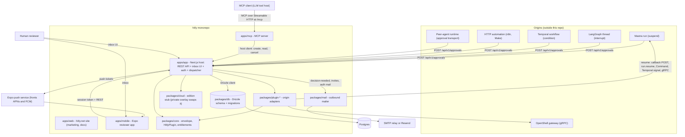

# HITLy component architecture

This directory describes the components of the HITLy monorepo: what each one is
for, where it lives, the interfaces it exposes, how it talks to the others, and
which environment variables (names only, never values) it reads.

Everything here is derived from the code in this repository at the commit the
page was written against. Anything the code could not confirm is marked
"unconfirmed".

## What HITLy is

HITLy is a human-in-the-loop approval inbox. An origin (an agent run, a
workflow, or an automation) pauses before a sensitive action and POSTs an
approval envelope to the HITLy host. A human reviews it in the web inbox or the
mobile app and decides. HITLy then resumes the origin through the matching
plugin. The pause primitive always stays in the origin framework; HITLy owns
the review.

## Components

| Component | Lives in | Page |
| --- | --- | --- |
| Web app (reviewer inbox + host shell) | `apps/app` | [web-app.md](web-app.md) |
| Website (marketing + docs) | `apps/web` | [website.md](website.md) |
| Mobile app (Expo reviewer client) | `apps/mobile` | [mobile-app.md](mobile-app.md) |
| MCP server | `apps/mcp` | [mcp-server.md](mcp-server.md) |
| REST API host | `apps/app/app/api/v1` | [rest-api.md](rest-api.md) |
| Plugins (origin adapters) | `packages/plugin-*` | [plugins.md](plugins.md) |
| HITL spec (vendored fixtures) | `packages/core/src/fixtures/hitl-spec` | [hitl-spec.md](hitl-spec.md) |
| HITLy Cloud + `hitly-cloud` overlay | `packages/cloud` (public stub) | [cloud.md](cloud.md) |
| Email | `packages/mail` | [email.md](email.md) |
| Push (Expo / FCM) | `apps/app/lib/push*.ts`, `apps/mobile` | [push.md](push.md) |
| Database | `packages/db` | [database.md](database.md) |
| Core domain library | `packages/core` | (covered across pages) |

`@hitly/core` is the shared domain layer: the approval envelope, the
`HitlyPlugin` interface, plugin ids, decisions, roles, entitlements, JSON
Canonicalization (JCS), answer schemas, evidence types, and the outbound
destination-check policy. It has no page of its own because it is the contract
every other page references.

## Component diagram

## Data and decision flow

1. The origin pauses with its framework primitive (`suspend()`,
   `interrupt()`, a wait node, a `condition()`, or an approval transport).
2. The origin (or an MCP client through `apps/mcp`) POSTs the approval
   envelope to `POST /api/v1/approvals`, authenticated with a project API key.
   The matching plugin validates it via `HitlyPlugin.ingest`.
3. The host stores the approval in Postgres and fans out notifications: email
   through `packages/mail` and a push ticket through the Expo push service.
4. A reviewer opens the inbox (web or mobile), then accepts, edits, rejects,
   responds, ignores, or cancels. The decision is recorded durably
   (`decision_records`) with project events and evidence.
5. Unless the decision is "ignore", the host calls `HitlyPlugin.resume` for
   the approval's plugin, which resumes the origin (callback POST to a
   `resumeUrl`, `run.resume`/`bail`, a LangGraph `Command`, a Temporal signal,
   or a gateway call). A failed resume sets status `failed_resume` and can be
   retried via `retry-resume`.
6. The origin branches on the decision payload (`{ approved }` for agent
   frameworks, `{ decision, id, metadata }` for HTTP callbacks).

## Repo roles

Every workspace package declares `hitly.role` in its `package.json`:
`sdk` (publishable later: core, mail, plugins), `app` (app, web, mobile),
`internal` (db, ui), `edition-stub` (cloud), and `example` (samples under
`examples/`).

## Reading rules for these pages

- Environment variables are listed by name only; values, secrets, and
  deployment endpoints never appear here.
- Internal or private hostnames are intentionally absent.
- Items the code could not confirm are marked "unconfirmed".
