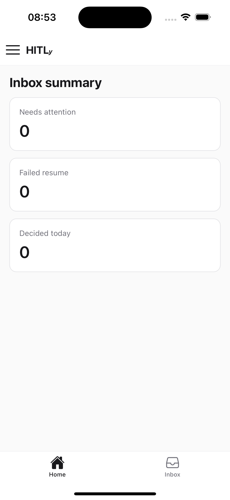
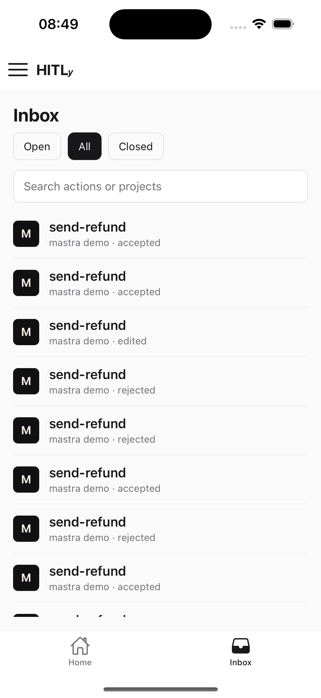
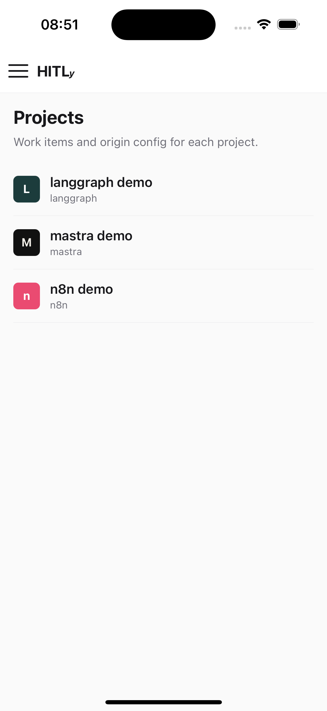
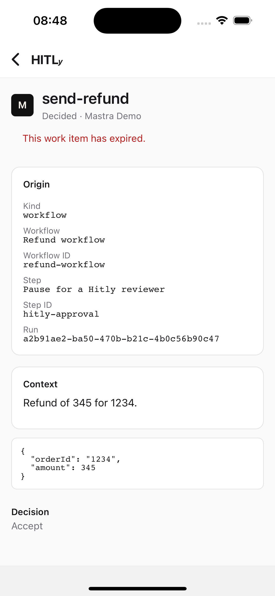

# HITLy mobile app

Reviewer-first Expo (React Native) app for iOS and Android. One binary signs into **HITLy Cloud** or a **self-hosted** instance, receives native push, and opens the approval that needs a decision.

Web remains the admin surface (projects, keys, rules, channels, billing). Mobile owns inbox, decide, and attention.

Package: [`apps/mobile`](../apps/mobile) (`@hitly/mobile`, `hitly.role: app`).

## Framework

**Expo SDK + Expo Router**, not Flutter, Capacitor, or a PWA wrapper.

- Same TypeScript stack as the monorepo. Share types from `@hitly/core` (`ApprovalEnvelope`, `Decision`, `AllowedActions`, `OriginRef`).
- Native APNs/FCM via `expo-notifications` and EAS.
- Deep links via Expo Router, custom scheme `hitly://`, and associated domains on Cloud.
- Do **not** import `@hitly/ui` (DOM + Tailwind). Mobile primitives live in `apps/mobile`. Visual language stays zinc/neutral to match the web app.

## Product split

| Mobile (v1) | Web only |
| --- | --- |
| Instance + login | Team invites, workspace members |
| Home attention + inbox | Rules, people, logs, channels |
| Work item detail + decide / retry | Billing (Cloud) |
| Workspace switch + workspace settings | API key create / rotate |
| Projects list, project inbox, project config | |
| Notification + deep-link settings | |

Delegate, audit tables, SSO, Slack/Telegram, and project admin stay on web.

## Navigation

Expo Router file-based routes. Tabs are Home and Inbox. A **system bar** at the top shows HITLy branding, the hamburger, and an alert when pending or failed-resume items need a decision. A hamburger menu opens Workspace, Projects, Config, and the same Home/Inbox destinations. Work item detail sits **outside** the tab navigator so a cold-start push can open it without flashing Home.

```
(auth)
  InstanceGate → HostedUrlForm → LoginScreen → SignupScreen
(tabs)
  HomeScreen | InboxListScreen
workspace
  WorkspaceScreen          // switch + name / timezone / SLA
projects
  ProjectListScreen
  projects/[id]
    ProjectItemsScreen
    config                 // origin config (admins)
settings
  ConfigScreen             // instance, notifications, sign out
inbox/[id]
  WorkItemDetailScreen     // deep-link target
```

Deep-link target is always one approval, matching email URLs `{APP_URL}/inbox/{approvalId}`.

## Screenshots

Home (inbox summary), Inbox, Projects, and a decided `send-refund` work item:









## Auth: Cloud or hosted

There is no in-app edition toggle on the web — Cloud vs OSS is package presence. The **mobile client** is where the human chooses the server.

### InstanceGate

- **HITLy Cloud** — lock `baseUrl` to `https://cloud.hitly.net`.
- **Hosted** — user enters origin (normalize `https://`, strip trailing slash). Probe `GET /api/v1/health`. Persist `{ baseUrl, label }` in SecureStore.

### Login

Email + password against `{baseUrl}/api/auth/sign-in/email` (Better Auth). The JSON body includes `token`. Store it in SecureStore and send `Authorization: Bearer <token>` on reviewer APIs.

The server enables Better Auth’s `bearer()` plugin so native clients do not depend on a cookie jar. Also send `x-hitly-workspace-id` after the user picks a workspace (web still uses the `hitly-workspace-id` cookie).

Cloud SSO is out of v1.

### SessionProvider

Holds `baseUrl`, session token, user, current workspace, and a pending deep-link. If a push or universal link arrives for a **different** `baseUrl` than the signed-in instance, show `InstanceMismatchSheet`.

## Component tree

```
apps/mobile/
  app/
    _layout.tsx                    RootProviders
    index.tsx                      Redirect by session
    (auth)/
      _layout.tsx
      index.tsx                    InstanceGate
      hosted.tsx                   HostedUrlForm
      login.tsx                    LoginScreen
      signup.tsx                   SignupScreen
    (tabs)/
      _layout.tsx
      index.tsx                    HomeScreen
      inbox.tsx                    InboxListScreen
    workspace.tsx                  WorkspaceScreen
    projects/
      index.tsx                    ProjectListScreen
      [id]/index.tsx               ProjectItemsScreen
      [id]/config.tsx              ProjectConfigScreen
    settings.tsx                   ConfigScreen
    inbox/[id].tsx                 WorkItemDetailScreen
  src/
    providers/SessionProvider.tsx
    providers/NotificationProvider.tsx
    api/hitly-client.ts
    linking.ts
    components/…
```

### Component contracts

**AttentionSummary / AttentionCard** — Home. Maps `GET /api/v1/inbox/summary`: `pending` is “needs attention”; also surface `failedResume`. Tap opens inbox (scoped) or the oldest pending item.

**InboxScopeTabs / InboxSearch / WorkItemList / WorkItemRow / SlaChip** — List. Fields from `GET /api/v1/inbox`: `id`, `status`, `actionName`, `plugin`, `projectName`, `createdAt`, `expiresAt`. Mobile **shows `expiresAt`** (the web list does not). Plugin glyph uses the same brand colors as `@hitly/ui` `PLUGIN_BRANDS`, reimplemented in RN.

**WorkItemDetailScreen** — Status, origin fields, context markdown, args, decision history, `DecisionBar`. Data from `GET /api/v1/approvals/:id`.

**DecisionBar** — Sticky actions from `envelope.allowedActions` (`accept` | `reject` | `edit` | `respond` | `ignore`). Posts `POST /api/v1/approvals/:id/decide`. `edit` / `respond` open sheets. Hidden when `canAct` is false.

**RetryResumeButton** — `status === 'failed_resume'` → `POST /api/v1/approvals/:id/retry-resume`.

**StatusHeader overflow** — `canCancel` (`pending` or `failed_resume`) → ⋮ next to the title → Force cancel → `POST /api/v1/approvals/:id/cancel`. Does not resume the origin.

**WorkspacePicker** — `GET /api/v1/workspaces` + `POST /api/v1/workspaces/current`. On the Workspace screen.

**WorkspaceScreen** — `GET`/`PATCH /api/v1/workspace` for name, timezone, and default SLA.

**ProjectListScreen / ProjectItemsScreen** — `GET /api/v1/projects`, then inbox filtered by `projectId`.

**ProjectConfigScreen** — `GET`/`PATCH /api/v1/projects/:id/config` (project admins). Does not create or reveal ingest API keys.

**InstanceCard / NotificationToggle / SignOutButton** — Config.

## Reviewer REST (session auth)

Do **not** use project API keys (`hitly_…`) from the mobile app. Those are requester credentials for origins (create, read, cancel and list their own requests).

Reviewer routes authenticate with Better Auth: session cookie (web) or `Authorization: Bearer <session token>` (mobile). Workspace scope: cookie `hitly-workspace-id` or header `x-hitly-workspace-id`.

| Method | Path | Auth | Purpose |
| --- | --- | --- | --- |
| `GET` | `/api/v1/health` | Public | Probe a hosted URL. `{ "ok": true, "product": "hitly", "edition": "oss" \| "cloud" }` |
| `GET` | `/api/v1/inbox` | Session | List items. Query: `scope=all\|open\|closed`, `q`, `projectId` |
| `GET` | `/api/v1/inbox/summary` | Session | `{ pending, failedResume, decidedToday, projectCount }` |
| `GET` | `/api/v1/approvals/:id` | Session | Detail: envelope, origin, `originFields`, decisions, `canAct`, `answerSchema` |
| `GET` | `/api/v1/approvals/:id/original-request` | Session | Canonical JSON of the stored create-once request (see below) |
| `POST` | `/api/v1/approvals/:id/decide` | Session | Decide JSON (see *Decide & answer gating*) |
| `POST` | `/api/v1/approvals/:id/opens` | Session | `{ "ref" }` — record that THIS reviewer opened a context item |
| `POST` | `/api/v1/approvals/:id/retry-resume` | Session | Existing retry |
| `POST` | `/api/v1/approvals/:id/cancel` | Session | Force-close without origin resume |
| `GET` | `/api/v1/workspaces` | Session | Memberships for the user |
| `POST` | `/api/v1/workspaces/current` | Session | `{ "workspaceId" }` — sets cookie; mobile also stores the id and sends the header |
| `GET` | `/api/v1/workspace` | Session | Current workspace: name, timezone, SLA, `canManage` |
| `PATCH` | `/api/v1/workspace` | Session | `{ "name", "timezone", "sla" }` — workspace admins |
| `GET` | `/api/v1/projects` | Session | Visible projects |
| `GET` | `/api/v1/projects/:id` | Session | Project summary + `canAdmin` |
| `GET` | `/api/v1/projects/:id/config` | Session | Config fields (admins). Origin token is write-only |
| `PATCH` | `/api/v1/projects/:id/config` | Session | Name, SLA, assignee, origin URL / token |
| `POST` | `/api/v1/devices` | Session | Register Expo push token |
| `DELETE` | `/api/v1/devices` | Session | Unregister `{ "token" }` |

### Health

```json
{ "ok": true, "product": "hitly", "edition": "oss" }
```

Hosted URL validation: GET this path; require `ok === true` and `product === "hitly"`.

### Inbox list

`GET /api/v1/inbox?scope=open&q=refund&projectId=prj_…&limit=50`

Query: `scope`, `q`, `projectId`, `limit` (1–200, default 100), `cursor` (opaque; pass `nextCursor` from the previous page). Invalid `cursor` is `400`. Order is `created_at DESC, id DESC`.

```json
{
  "items": [
    {
      "id": "apr_…",
      "status": "pending",
      "actionName": "send-refund",
      "plugin": "mastra",
      "projectId": "prj_…",
      "projectName": "Acme refunds",
      "createdAt": "2026-08-13T18:00:00.000Z",
      "expiresAt": "2026-08-13T19:00:00.000Z"
    }
  ],
  "nextCursor": null
}
```

`open` = `pending` + `failed_resume`. `closed` = `decided` + `expired` + `cancelled`.

### Approval detail

```json
{
  "id": "apr_…",
  "status": "pending",
  "actionName": "send-refund",
  "plugin": "mastra",
  "projectId": "prj_…",
  "projectName": "Acme refunds",
  "assignedUserId": "usr_…",
  "createdAt": "2026-08-13T18:00:00.000Z",
  "expiresAt": "2026-08-13T19:00:00.000Z",
  "answerSchema": null,
  "envelope": {
    "action": { "name": "send-refund", "args": { "orderId": "1842" } },
    "allowedActions": { "accept": true, "reject": true, "edit": false, "respond": false, "ignore": false },
    "contextMarkdown": "Refund £20 to order 1842."
  },
  "origin": { "plugin": "mastra", "projectId": "prj_…", "runId": "run_…", "resumeHandle": {} },
  "originFields": [{ "key": "runId", "label": "Run", "value": "run_…" }],
  "canAct": true,
  "openedRefs": [],
  "decisions": []
}
```

#### `openedRefs`

`openedRefs` is the list of **gating keys** (hitl-spec 3.7 `ref`) that **this reviewer** has already recorded as opened on this approval.

- **What it is.** Distinct from the envelope's `mustOpen` flags. `mustOpen` is declared on context links/attachments at ingest. `openedRefs` is the reviewer's own open history for those keys (`policy`, a url, `name:url`, …). Another reviewer's opens never appear here.
- **When it is set.** `GET /api/v1/approvals/:id` (session / reviewer Bearer) includes `openedRefs` when the item is **actionable for this reviewer** (`canAct`). The host builds it from `opened` project events recorded by `POST /api/v1/approvals/:id/opens` (each event carries `itemRef`, `openedAt`, and the actor). The field is **omitted** when the reviewer cannot act (already decided, expired, cancelled, or no decide permission) — there is nothing to hydrate.
- **How clients use it.** Reviewer clients (mobile and web) hydrate the must-open checklist from `openedRefs` on load, then union in taps from the current visit. Re-entering an approval does not force opening every item again, and a tap on an already-recorded ref should not POST another `opened` event from the checklist. The host still re-validates on decide against the recorded events, not against this field.

A project API key on the same GET route still returns the slim origin-poll payload and never includes `openedRefs`. That payload does include top-level `answerSchema` (the stored ask_user schema, or `null` when the request has none).

### Original request (view / copy)

`GET /api/v1/approvals/:id/original-request` (session auth) returns the stored create-once `hitl/request/v0` record (host-normalised envelope) for reviewer verification. It is **not** the requester's raw wire bytes: key order, whitespace, `\u` escapes and number forms are normalised at ingest. The web detail page shows it under "View original request" with **Copy** and **Download (JSON)**.

- **Redacted JSON.** Display, copy and download redact `cb_auth_token`, resume handles, and secret-like fields (the read path strips them; the UI redacts again). `editedArgs` are never shown as the request — they have their own labelled section after a decide/edit.
- **Hashes of the stored original.** `payloadHash` and `argsHash` are hitl-spec `b64url(SHA-256(JCS(...)))` over the stored (pre-redaction) payload and action args, so a reviewer can verify off-host. `payloadSha256` / `argsSha256` remain hex over Hitly `canonicalJson` for the evidence chain.
- **Same viewers as the approval detail.** A signed-in workspace member with project access can read it. **Unauthenticated requests get `401`** (independent of the id). A session with no workspace, unknown ids, other workspaces and members without project access all get `404`. Project API keys cannot read it (a bare bearer key with no session is refused as `401`). Responses are `Cache-Control: no-store`.
- **Never logged.** Payload contents are never written to logs. Logs carry only ids and hashes.
- **Known limitation (ingest precision).** Integers above `Number.MAX_SAFE_INTEGER` lose precision at ingest `JSON.parse` (for example `12345678901234567890` is stored and served as `12345678901234567000`). That is a property of the stored record; this view does not attempt to repair it.

### Decide & answer gating

`POST /api/v1/approvals/:id/decide` body (JSON):

| Field | Type | Notes |
| --- | --- | --- |
| `decision` | string | **Required.** `accept` \| `reject` \| `edit` \| `respond` \| `ignore` \| `cancel`; must be allowed by the envelope's `allowedActions` |
| `reason` | string | Reviewer's typed reason (spec 3.6). Stored, audited (evidence `oversight.reason`) and forwarded to the origin **verbatim** — trimming is only used for the emptiness check |
| `response` | string | Free response text for the answer |
| `editedArgs` | object | Required for `edit`; keys limited to the envelope's `editableFields` |
| `editReason` / `editReasonText` | string | Edit dropdown pick + free text, per the envelope's `editReason` config |

Answer rules come from the envelope (spec 3.6/3.7):

- `reasonRequired`: answer values that need a non-empty `reason`. Absent, binary-shaped
  requests (accept+reject only) default to `["reject"]`; an explicit `[]` opts out.
- `externalUrls[]` / `attachments[]` entries carry an optional `ref` — the gating key
  (defaults to the url for links, `name:url` for attachments) — and `mustOpen: true`
  gates the answer on that item being opened.

The host re-validates every decide with the exact rules the clients mirror
(`validateAnswerSubmission` in `@hitly/core`). A refused answer returns `400` with
field errors:

```json
{
  "error": "reason: A reason is required for this answer.",
  "fields": [{ "field": "reason", "message": "A reason is required for this answer." }]
}
```

`field` is `reason` or `context.items.<ref>`. `mustOpen` gates **acting** answers
(accept, reject, edit, respond): while a must-open item is unopened for the deciding
reviewer, web, mobile and the host all refuse those answers. **Ignore/dismiss is
exempt** — it takes no action, so it stays available without opening context.

### Open a context item

`POST /api/v1/approvals/:id/opens` body `{ "ref": "policy" }` records that **this**
reviewer opened the item, as an `opened` audit event carrying `openedAt`. `ref` is the
item's gating key (its raw url is also accepted). Response:

```json
{ "ok": true, "ref": "policy", "openedAt": "2026-08-13T18:05:00.000Z" }
```

Opens are per reviewer and repeatable (every open is audited). The host never fetches
the target itself: the client opens the real URL (new tab / in-app browser) and reports
the open here. Those events are what `openedRefs` on the approval detail is built from.

### Workspaces

`GET /api/v1/workspaces`

```json
{
  "workspaces": [{ "id": "ws_…", "name": "Acme", "slug": "acme", "plan": "self-hosted", "role": "owner" }],
  "currentId": "ws_…"
}
```

`POST /api/v1/workspaces/current` body `{ "workspaceId": "ws_…" }` → `{ "currentId": "ws_…" }`.

### Devices

`POST /api/v1/devices`

```json
{ "token": "ExponentPushToken[…]", "platform": "ios" }
```

`platform` is `ios` or `android`. Upsert by token (reassign if the device previously belonged to another user).

`DELETE /api/v1/devices` body `{ "token": "ExponentPushToken[…]" }`.

## Push: `user_devices` and Expo

v1 **always pushes the assignee** when they have a registered device, in addition to email. Do not wait on a project `push` channel. Slack/Telegram stay stubs. `ntfy` is a later air-gapped `CHANNEL_TYPES` option, not required for the first store build.

### Table `user_devices`

| Column | Type | Notes |
| --- | --- | --- |
| `id` | `varchar(36)` PK | `dev_…` |
| `user_id` | FK `users.id` | cascade delete |
| `expo_push_token` | `varchar(255)` unique | Expo push token |
| `platform` | `enum('ios','android')` | |
| `created_at` / `updated_at` | timestamp(3) | |

The instance is implied by the server. Self-hosted operators do not need their own APNs/FCM certs: they send through Expo Push using tokens from the official HITLy app.

### Payload

On ingest, `notifyAssignee` also POSTs to `https://exp.host/--/api/v2/push/send`:

```json
{
  "title": "HITLy: send-refund needs a decision",
  "body": "Acme refunds · expires in 15m",
  "data": {
    "type": "approval",
    "approvalId": "apr_…",
    "instanceUrl": "https://cloud.hitly.net"
  }
}
```

`instanceUrl` is `BETTER_AUTH_URL` / `NEXT_PUBLIC_APP_URL` so the client can detect Cloud vs hosted mismatch.

Optional `EXPO_ACCESS_TOKEN` raises Expo Push rate limits. Without it, unauthenticated Expo Push still works at lower volume.

### Client

`NotificationProvider` requests permission, gets an Expo push token, `POST /api/v1/devices`. Tap handler reads `data.approvalId` + `data.instanceUrl` and runs the same resolver as a universal link. Sign-out calls `DELETE /api/v1/devices`.

## Deep navigation

Three entry points, one resolver `resolveAttentionLink({ approvalId, instanceUrl })`:

| Source | Payload |
| --- | --- |
| Universal / App Link | `https://cloud.hitly.net/inbox/:id` (Cloud). Hosted: Next serves `.well-known` association files when `HITLY_MOBILE_APP_ID` is set. |
| Custom scheme | `hitly://inbox/:id?host=<urlencoded-baseUrl>` |
| Push tap | `data.approvalId` + `data.instanceUrl` |

1. Logged out → stash pending link → InstanceGate / Login → then open detail.
2. `instanceUrl` ≠ session `baseUrl` → `InstanceMismatchSheet`.
3. Else `router.push('/inbox/' + approvalId)`.

Cold start: `getLastNotificationResponseAsync` + `Linking.getInitialURL` in the root layout.

## Associated domains

Cloud (`cloud.hitly.net`) should publish:

- `/.well-known/apple-app-site-association`
- `/.well-known/assetlinks.json`

Self-hosted instances can set `HITLY_MOBILE_APP_ID` (e.g. `net.hitly.app`), `HITLY_IOS_TEAM_ID`, and `HITLY_ANDROID_SHA256` so the Next app serves the same files and email links can open the official app.

## Run locally

```bash
yarn install
yarn db:migrate
yarn dev:app          # API + Better Auth on :3001
yarn dev:mobile       # Expo
```

Point the hosted login at `http://localhost:3001` (or your LAN IP from a device).
